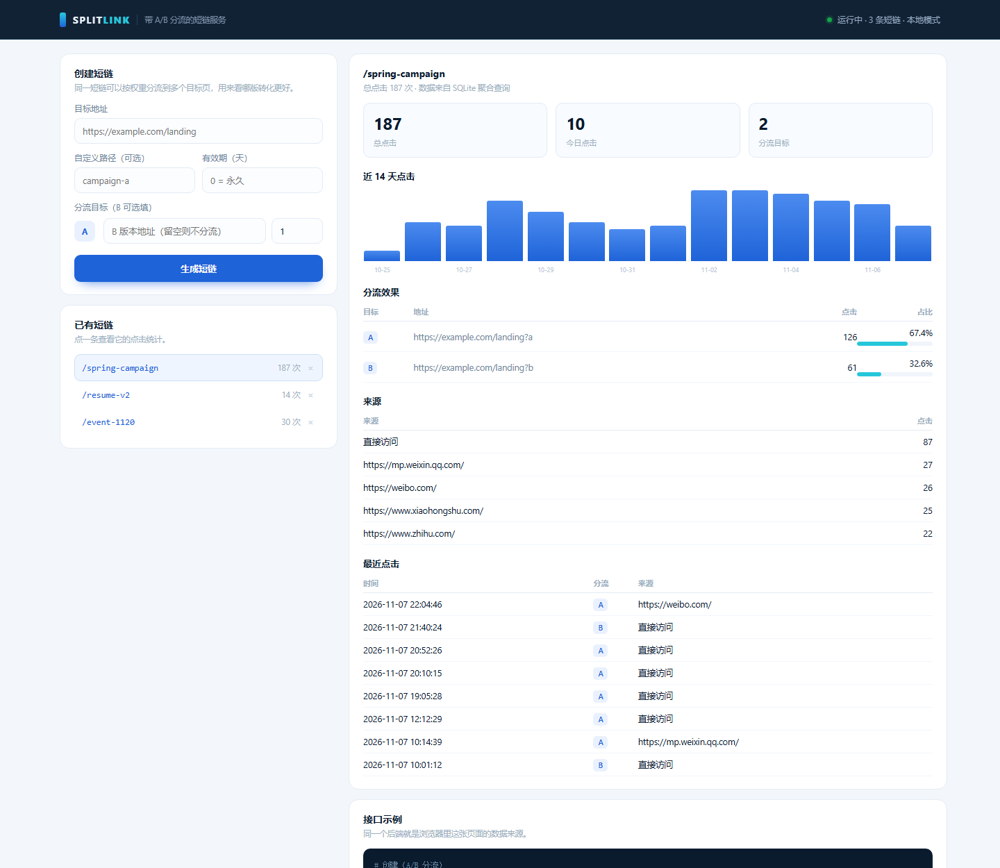

# SplitLink — URL shortener with built-in A/B routing

> One link, weighted across multiple landing pages, plus the data to tell which page actually wins.



**Stack**: Python 3.10+ standard library only (`http.server` + `sqlite3`). **Zero dependencies.**
**Size**: ~700 lines of implementation, 10 API tests, 8 commits.

---

## Why not just another shortener

A plain shortener answers "this URL is too long". It does not answer what a growth team actually asks: **does the traffic convert better on page A or page B?**

SplitLink adds one step: a single `/spring-campaign` link can route visitors to two landing pages at a 2:1 ratio, and stats break down by route. You can compare copy, layout or pricing without waiting for an experimentation platform.

---

## Quick start

```bash
python app.py
# open http://127.0.0.1:8787/
```

Want data to look at first:

```bash
python scripts/seed_demo.py      # 3 links + 14 days of clicks
python -m unittest discover -s tests -v
```

---

## API

| Method | Path | Description |
|---|---|---|
| `GET` | `/api/health` | Health, link count, uptime, auth mode |
| `POST` | `/api/links` | Create a link (optionally with weighted variants) |
| `GET` | `/api/links` | 20 most recent links |
| `GET` | `/api/links/<slug>` | Link detail |
| `GET` | `/api/links/<slug>/stats` | 14-day series, per-variant split, referrers, recent clicks |
| `DELETE` | `/api/links/<slug>` | Delete link and its click records |
| `GET` | `/<slug>` | 302 redirect, weighted pick, records one click |

```bash
curl -X POST http://127.0.0.1:8787/api/links \
  -H "Content-Type: application/json" \
  -d '{
    "url": "https://example.com/a",
    "slug": "spring-campaign",
    "expires_in_days": 30,
    "variants": [
      {"url": "https://example.com/a", "weight": 2, "label": "A"},
      {"url": "https://example.com/b", "weight": 1, "label": "B"}
    ]
  }'
```

Errors share one shape:

```json
{"error": {"code": "invalid_request", "message": "only http/https links are allowed"}}
```

`400` invalid input · `401` missing token · `404` not found · `409` slug taken · `410` expired · `429` rate limited (with `Retry-After`) · `500` server error.

---

## Data model

```
links(slug PK, created_at, expires_at, owner, hits)
  └─ variants(id PK, slug FK, label, target, weight)
clicks(id PK, slug, variant_id, ts, referer, ua, ip_hash)
   └─ idx_clicks_slug_ts (slug, ts)
```

- Targets live in their own table, so adding a variant never changes the schema.
- Clicks stay as raw rows; every statistic is an aggregate, nothing is pre-computed.
- `links.hits` is a denormalised counter so the list view avoids `COUNT(*)` on every request.

---

## Deliberate engineering choices

1. **Reject private network targets** — only `http/https`, no `localhost`, no RFC1918 ranges. Otherwise the service becomes a ready-made SSRF pivot.
2. **Hash IPs** — `sha256("splitlink:" + ip)[:16]`. Enough for dedupe and coarse analysis, never stores a raw visitor IP (logs included).
3. **Token bucket rate limiting** — 30 writes/min, 300 redirects/min per IP; `429` carries `Retry-After`.
4. **No caching on redirects** — `Cache-Control: no-store`, otherwise a browser or CDN caches the 302 and both routing and stats silently break.
5. **Optional auth** — set `SPLITLINK_TOKEN` and `POST`/`DELETE` require `Authorization: Bearer <token>`. Unset means local dev mode.
6. **Structured logs** — one JSON object per line with fixed fields.

---

## Known limits

1. In-process rate limiting: resets on restart, not shared across instances.
2. SQLite single-writer: fine for reads-heavy link traffic, needs Postgres at scale.
3. No account system: links are globally visible and deletable.
4. Click recording is synchronous: high traffic wants a queue.
5. No click de-duplication: one person clicking 100 times counts 100 times.

These are stated boundaries, not TODOs — being able to explain them is worth more than pretending the service is production-ready.

---

## Layout

```
splitlink/
├─ app.py               HTTP server, routing, auth, rate-limit wiring
├─ store.py             SQLite storage and aggregate queries
├─ validate.py          Input validation (including SSRF protection)
├─ ratelimit.py         Token bucket
├─ demo.py              Demo data generator
├─ static/index.html    Console UI (vanilla JS)
├─ scripts/seed_demo.py CLI wrapper for demo data
├─ tests/test_api.py    10 API tests
├─ render.yaml          One-click blueprint for Render
└─ Dockerfile
```

---

## Deploy

**Render (free)**: create a Blueprint from this repo — `render.yaml` sets the start command, health check and demo seeding.

```bash
# or Docker
docker build -t splitlink .
docker run -p 8787:8787 -e SPLITLINK_HOST=0.0.0.0 splitlink
```

Note: on free tiers the filesystem is ephemeral, so the SQLite file resets on every deploy. The demo seeder repopulates it automatically when `SPLITLINK_DEMO=1`.

---

## Related projects

- **Retail Insight** (data) → [nanyang182/retail-insight](https://github.com/nanyang182/retail-insight)
- **JD Lens** (frontend / product) → [nanyang182/jd-lens](https://github.com/nanyang182/jd-lens)
