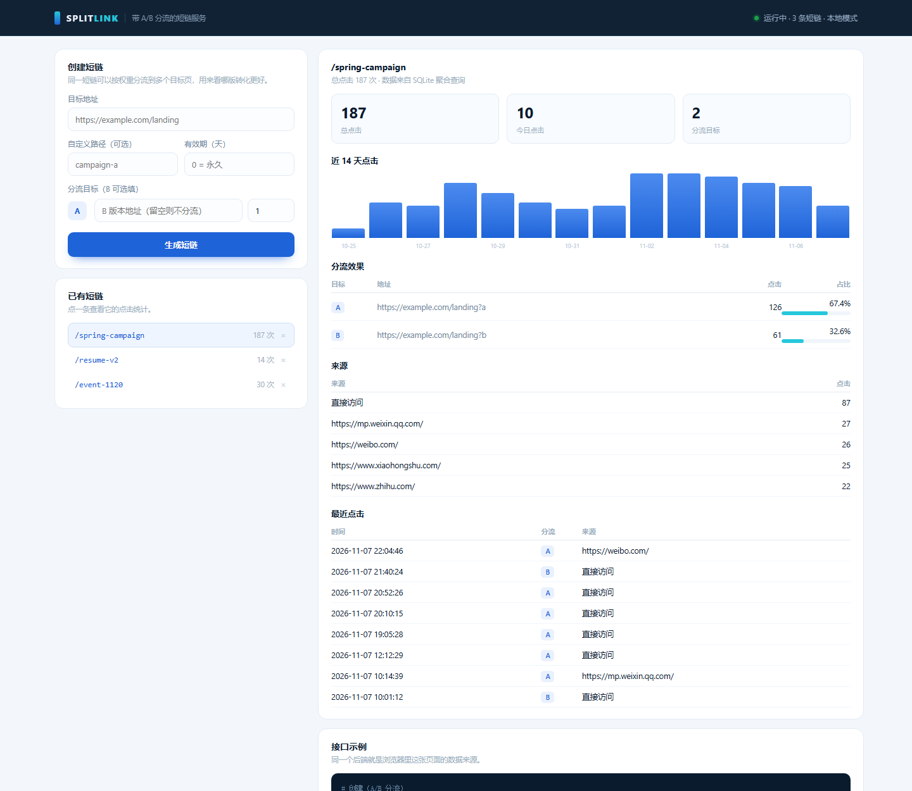

# SplitLink · 带 A/B 分流的短链服务

**中文** ｜ [English](README.en.md)

> 一条短链，按权重分流到多个目标页，并告诉你哪一版真的被点开了。



**技术栈**：Python 3.10+ 标准库（`http.server` + `sqlite3`），**零第三方依赖**
**规模**：约 700 行实现 + 10 个接口测试

---

## 一、为什么不直接做"普通短链"

普通短链只解决"链接太长"，它回答不了运营最关心的问题：**把用户导到 A 页还是 B 页，效果有什么差别。**

所以这个服务在短链的基础上多做了一步——**分流**：一条 `/spring-campaign` 可以按 2:1 的权重把访客分到两个落地页，再按分流维度统计点击。这样"改版/投放/文案"的对比，不用等 A/B 平台排期，自己就能跑。

---

## 二、快速开始

```bash
python app.py
# 打开 http://127.0.0.1:8787/
```

想先看效果，可以灌一批演示数据：

```bash
python scripts/seed_demo.py   # 3 条短链 + 最近 14 天点击
```

跑测试：

```bash
python -m unittest discover -s tests -v     # 10 passed
```

---

## 三、接口

| 方法 | 路径 | 说明 |
|---|---|---|
| `GET` | `/api/health` | 健康检查（含短链数、运行时长、鉴权模式） |
| `POST` | `/api/links` | 创建短链，可带多目标分流 |
| `GET` | `/api/links` | 最近 20 条 |
| `GET` | `/api/links/<slug>` | 短链详情 |
| `GET` | `/api/links/<slug>/stats` | 点击统计（14 天序列 / 分流 / 来源 / 最近） |
| `DELETE` | `/api/links/<slug>` | 删除（连带点击记录） |
| `GET` | `/<slug>` | 302 跳转，按权重选目标并记一次点击 |

**创建示例**

```bash
curl -X POST http://127.0.0.1:8787/api/links \
  -H "Content-Type: application/json" \
  -d '{
    "url": "https://example.com/a",
    "slug": "spring-campaign",
    "expires_in_days": 30,
    "variants": [
      {"url": "https://example.com/a", "weight": 2, "label": "A"},
      {"url": "https://example.com/b", "weight": 1, "label": "B"}
    ]
  }'
```

```json
{
  "slug": "spring-campaign",
  "short_url": "http://127.0.0.1:8787/spring-campaign",
  "expires_at": "2026-12-07T08:00:00Z",
  "variants": [
    {"label": "A", "target": "https://example.com/a", "weight": 2},
    {"label": "B", "target": "https://example.com/b", "weight": 1}
  ]
}
```

**错误格式统一**

```json
{"error": {"code": "invalid_request", "message": "只支持 http / https 链接"}}
```

| 状态码 | 场景 |
|---|---|
| 400 | 参数不合法（URL、slug、权重） |
| 401 | 开启了鉴权但没带 token |
| 404 | 短链不存在 |
| 409 | 自定义 slug 被占用 |
| 410 | 短链已过期 |
| 429 | 触发限流（带 `Retry-After`） |
| 500 | 服务端异常 |

---

## 四、数据模型

```
links(slug PK, created_at, expires_at, owner, hits)
  └─ variants(id PK, slug FK, label, target, weight)
clicks(id PK, slug, variant_id, ts, referer, ua, ip_hash)
   └─ idx_clicks_slug_ts (slug, ts)
```

三个设计考虑：

1. **目标和短链分开存**：一个短链 N 个目标，加分流不用改表结构。
2. **clicks 独立成表**：统计维度（时间、分流、来源）都从明细聚合，不预先算死。
3. **`links.hits` 冗余计数**：列表页不必每次 `COUNT(*)`，代价是写入时多一次 UPDATE。

---

## 五、几个刻意做的工程决定

**① 拒绝内网地址**
创建时校验目标 URL：只允许 http/https，拒绝 `localhost`、`127.0.0.1`、私有网段。否则这个服务会变成一个现成的 SSRF 跳板。

**② IP 只存哈希**
`sha256("splitlink:" + ip)[:16]`，够做去重和粗粒度分析，又不会把访客 IP 明文落库。日志同理。

**③ 令牌桶限流**
写接口 30 次/分钟、跳转 300 次/分钟，按 IP 分桶，超限返回 429 + `Retry-After`。进程内实现，够单机用；多实例要换成 Redis。

**④ 跳转不缓存**
`Cache-Control: no-store`。否则浏览器或 CDN 缓存 302，分流和统计都会失真。

**⑤ 写操作可选鉴权**
设置 `SPLITLINK_TOKEN` 环境变量后，`POST`/`DELETE` 需要 `Authorization: Bearer <token>`；不设置则是本地开发模式（日志会提示）。默认开放是为了本地跑得顺手，不是给生产用的。

**⑥ 结构化日志**
一行一条 JSON，字段固定（ts / ip_hash / method / path / msg），方便直接喂给日志系统。

---

## 六、它现在还不行的地方

1. **单机内存限流**：进程重启计数清零，多实例不共享——真要上生产得换 Redis。
2. **SQLite 单写**：写并发高了会锁等待；读多写少的短链场景够用，但量级上去要换 Postgres。
3. **没有账号体系**：`owner` 字段只是预留，短链默认所有人可见可删。
4. **统计是同步写**：每次跳转都插一条记录，高并发下应该改成"写队列 + 异步落库"。
5. **没有防刷**：同一个人连点 100 次会被算 100 次点击，缺少去重/频控维度。

这几条不是"以后再说"，是这份实现明确的边界——面试被追问时，能说清楚比假装完备更有用。

---

## 七、目录

```
splitlink/
├─ app.py              HTTP 服务、路由、鉴权、限流接入
├─ store.py            SQLite 存储与聚合查询
├─ validate.py         入参校验（含 SSRF 防护）
├─ ratelimit.py        令牌桶
├─ static/index.html   控制台（原生 JS，无框架）
├─ scripts/seed_demo.py 演示数据
├─ tests/test_api.py   10 个接口测试
└─ Dockerfile
```

---

## 八、Docker

```bash
docker build -t splitlink .
docker run -p 8787:8787 -e SPLITLINK_HOST=0.0.0.0 splitlink
```

---

## 九、部署到云端

**Render 免费实例（推荐）**：仓库里带了 `render.yaml` 蓝图，在 Render 里选 "New → Blueprint"，指向这个仓库即可，启动命令、健康检查、演示数据都配好了。

要注意两点：

1. **免费实例会休眠**：约 15 分钟无请求后休眠，下次访问要等 30 秒左右冷启动。演示前先点一次唤醒。
2. **文件系统是临时的**：每次重新部署，SQLite 文件会重置。所以 `render.yaml` 里设了 `SPLITLINK_DEMO=1`，空库时自动灌演示数据。

想持久化就把 `SPLITLINK_DB` 指到挂载盘（付费功能），或者把 `store.py` 换成 Postgres。

**Docker**：见下一节。

## 相关项目

同一个人的另外两个项目：

- **Retail Insight**（数据侧）→ [nanyang182/retail-insight](https://github.com/nanyang182/retail-insight)
  54 万条真实交易数据的分析看板。
- **JD Lens**（前端 / 产品侧）→ [nanyang182/jd-lens](https://github.com/nanyang182/jd-lens)
  粘一段招聘 JD，看清它在要什么、你还缺什么。
